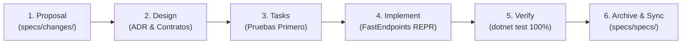

# ⚡ FastEndpoints + Clean Architecture: Template .NET 10 (AI-Native)

> **Template empresarial de grado de producción en C#** impulsado por **FastEndpoints (v8.3)**, preparado y verificado para **.NET 10** (compatible también con .NET 9), **Clean Architecture**, patrón **Vertical Slice REPR** (Request-Endpoint-Response), y una infraestructura autónoma completa para **Agentes de Inteligencia Artificial** (OpenSpec SDD, Antigravity Skills, reglas de Cursor, Claude Code y GitHub Copilot).

---

## 🌟 Características Principales

- **🚀 FastEndpoints v8.3**: Endpoints de alto rendimiento bajo el patrón REPR (*Request-Endpoint-Response*), eliminando los controladores MVC sobrecargados.
- **🏗️ Clean Architecture + Vertical Slices**: Separación clara y estricta en 4 capas (`Domain`, `Application`, `Infrastructure` y `Api`), donde cada caso de uso se organiza de manera cohesiva e independiente.
- **🛡️ Pruebas de Arquitectura Automatizadas**: Reglas integradas con `NetArchTest.Rules` que verifican que las capas no violen sus límites en cada compilación.
- **🗄️ Persistencia Dual (SQL Server & SQLite)**:
  - **Microsoft SQL Server**: Proveedor predeterminado con reintentos automáticos ante fallos transitorios (`EnableRetryOnFailure`).
  - **SQLite**: Fallback automático sin configuración previa (`app.db`) ideal para desarrollo local inmediato y ejecución offline.
- **⚡ Caché Distribuido con Redis**:
  - Soporte nativo para **Redis** (`StackExchangeRedis`) con health checks dedicados (`/health`).
  - Abstracción limpia `ICacheService` con serialización JSON tipada.
  - Fallback automático y transparente a memoria (`DistributedMemoryCache`) si no se dispone de un servidor Redis local.
- **📦 Central Package Management (CPM)**: Gestión centralizada y versionamiento unificado de paquetes NuGet mediante `Directory.Packages.props`.
- **🤖 Ecosistema Nativo para Agentes de IA**:
  - `AGENTS.md`: Guía maestra universal para cualquier agente de código asistido por IA.
  - `.agent/skills/`: Habilidades especializadas con plantillas (`.template`) y ejemplos reales de implementación (`.txt`) para generación de endpoints, migraciones EF Core, pruebas y revisión arquitectónica.
  - `.cursor/rules/` y `.cursorrules`: Reglas estrictas para el editor Cursor.
  - `CLAUDE.md`: Instrucciones y convenciones para Claude Code.
  - `.github/copilot-instructions.md`: Prompts contextuales para GitHub Copilot.
  - `specs/`: Ciclo de vida OpenSpec SDD (*Spec-Driven Development*) con especificaciones vivas y plantillas de diseño (`proposal`, `design`, `tasks`).
- **📑 Documentación OpenAPI / Swagger / Scalar**:
  - Swagger UI interactivo en `/swagger`.
  - Documentación visual moderna con Scalar en `/scalar/v1`.
  - Especificación OpenAPI v3 en `/openapi/v1.json`.
- **🩺 Observabilidad y Monitoreo**:
  - Logging estructurado de alto rendimiento con **Serilog** enriquecido por contexto.
  - Endpoint de Health Checks (`/health`) monitoreando base de datos y Redis.
- **🧪 Suite Completa de Pruebas (19/19 Tests pasando)**:
  - Pruebas Unitarias de Dominio y Validadores FluentValidation (`xUnit v3` + `FluentAssertions` + `NSubstitute`).
  - Pruebas de Caché Distribuido (`CacheServiceTests`).
  - Pruebas de Integración Web con fixture en memoria (`FastEndpoints.Testing` + `WebApplicationFactory`).
  - Pruebas de Gobernanza de Arquitectura (`NetArchTest.Rules`).
- **🐳 Listo para Contenedores**:
  - `Dockerfile` multi-etapa optimizado para producción.
  - `docker-compose.yml` preconfigurado con **API**, **Microsoft SQL Server 2022** y **Redis 7 (Alpine)** con comprobaciones de estado de salud (*health checks*).
- **🧩 Plantilla `dotnet new`**: Lista para instalarse y usarse globalmente en tu terminal mediante `dotnet new install .`.

---

## 📁 Estructura de la Solución

```
template-csharp-net10-fastendpoints/
├── .agent/                             <- Ecosistema de Agentes de IA
│   ├── roles/                          <- Roles de agentes (Backend Expert, Architecture Reviewer, Debugger)
│   └── skills/                         <- Habilidades con templates y ejemplos
│       ├── fastendpoints-feature-generator/
│       ├── architecture-guardian/
│       ├── efcore-migration-manager/
│       ├── test-generator/
│       └── ways-of-working/
├── .cursor/
│   └── rules/                          <- Reglas MDC para Cursor
├── .github/
│   └── copilot-instructions.md         <- Contexto para GitHub Copilot
├── .template.config/
│   └── template.json                   <- Configuración para instalar via 'dotnet new'
├── .vscode/                            <- Configuración lista para Visual Studio Code
│   ├── launch.json                     <- Perfiles F5 para depurar API y Tests
│   ├── tasks.json                      <- Tareas (build, test, watch, docker)
│   ├── settings.json                   <- Configuración recomendada del editor
│   └── extensions.json                 <- Extensiones sugeridas para C# y OpenAPI
├── deploy/
│   └── azure-pipelines.yml             <- Pipeline CI/CD para Azure DevOps
├── docs/                               <- Documentación técnica extendida
│   ├── ARCHITECTURE.md                 <- Diagramas Mermaid y reglas de diseño
│   ├── API_EXAMPLES.md                 <- Ejemplos completos de endpoints y DTOs
│   ├── AI_AGENT_WORKFLOW.md            <- Flujo de trabajo agéntico con IA
│   └── CODING_STANDARDS.md             <- Estándares y convenciones de código
├── specs/                              <- OpenSpec SDD (Spec-Driven Development)
│   ├── project.md                      <- Contexto general del sistema
│   ├── specs/catalog/spec.md           <- Especificación viva del catálogo
│   └── templates/                      <- Plantillas proposal, design, tasks, spec
├── src/
│   ├── FastEndpointsTemplate.Domain/   <- Entidades, Value Objects, Domain Events, Result<T>
│   ├── FastEndpointsTemplate.Application/ <- Interfaces (IApplicationDbContext, ICacheService), DTOs, Validadores
│   ├── FastEndpointsTemplate.Infrastructure/ <- EF Core (SQL Server / SQLite), Redis CacheService, Interceptores
│   └── FastEndpointsTemplate.Api/      <- Endpoints FastEndpoints REPR, Program.cs, Middlewares
├── tests/
│   ├── FastEndpointsTemplate.UnitTests/         <- Pruebas unitarias de dominio, validadores y caché
│   ├── FastEndpointsTemplate.ArchitectureTests/ <- Pruebas de barrera de capas NetArchTest
│   └── FastEndpointsTemplate.IntegrationTests/  <- Pruebas HTTP completas de endpoints
├── AGENTS.md                           <- Instrucciones maestras universales para agentes IA
├── CLAUDE.md                           <- Guía para Claude Code CLI
├── .cursorrules                        <- Reglas generales de desarrollo en Cursor
├── Directory.Build.props               <- Configuración global MSBuild (.NET 10 target)
├── Directory.Packages.props            <- Central Package Management (CPM)
├── Dockerfile                          <- Contenedor Linux multi-etapa
├── docker-compose.yml                  <- Orquestación local: API + SQL Server 2022 + Redis
├── requests.http                       <- Archivo interactivo para probar endpoints en VS Code
└── FastEndpointsTemplate.sln           <- Solución de Visual Studio
```

---

## 🚀 Puesta en Marcha Rápida

### Prerrequisitos
- [.NET 10 SDK](https://dotnet.microsoft.com/download/dotnet/10.0) (o .NET 9 SDK).
- [Docker Desktop](https://www.docker.com/) (opcional, para ejecutar con SQL Server y Redis en contenedores).
- [Visual Studio Code](https://code.visualstudio.com/) o Visual Studio 2022 / JetBrains Rider.

---

### Opción 1: Ejecución Local en Modo Ligero (SQLite + Memoria, Cero Dependencias)
No necesitas levantar ninguna base de datos ni servidor Redis para comenzar a programar de inmediato:

```powershell
# 1. Clonar el repositorio
git clone https://github.com/SabrinaSilvaR/Inacap.Template-.NET.git
cd Inacap.Template-.NET

# 2. Ejecutar la suite de pruebas automatizadas
dotnet test

# 3. Iniciar la API
dotnet run --project src/FastEndpointsTemplate.Api/FastEndpointsTemplate.Api.csproj
```

La API se iniciará en `http://localhost:5000` (o `https://localhost:5001`), creará automáticamente el archivo SQLite `app.db` y utilizará la caché en memoria transparente.

---

### Opción 2: Ejecución Completa con Docker Compose (SQL Server + Redis + API)
Para correr el entorno empresarial idéntico a producción con SQL Server 2022 y Redis 7:

```powershell
# Levantar todo el stack con compilación en segundo plano
docker compose up -d --build
```

Servicios levantados:
- **API**: `http://localhost:5000`
- **SQL Server 2022**: `localhost:1433` (Usuario: `sa`, Contraseña: `YourStrong@Passw0rd`)
- **Redis 7**: `localhost:6379`

Para detener los servicios:
```powershell
docker compose down
```

---

## 🧭 Documentación Interactiva y Health Checks

Una vez que la API esté en ejecución, puedes explorar:

| Recurso | URL | Descripción |
| :--- | :--- | :--- |
| **Swagger UI** | `http://localhost:5000/swagger` | Interfaz interactiva de Swagger OpenAPI |
| **Scalar API Reference** | `http://localhost:5000/scalar/v1` | Documentación visual moderna generada por Scalar |
| **OpenAPI Spec (JSON)** | `http://localhost:5000/openapi/v1.json` | Contrato OpenAPI estándar para clientes generadores |
| **Health Checks** | `http://localhost:5000/health` | Estado de salud de la base de datos (SQL Server/SQLite) y Redis |

---

## 🗄️ Configuración de Bases de Datos y Redis

Las cadenas de conexión y el proveedor se configuran en `src/FastEndpointsTemplate.Api/appsettings.json`:

```json
{
  "DatabaseProvider": "SqlServer",
  "ConnectionStrings": {
    "DefaultConnection": "Server=localhost,1433;Database=FastEndpointsDb;User Id=sa;Password=YourStrong@Passw0rd;TrustServerCertificate=True;MultipleActiveResultSets=True;",
    "Redis": "localhost:6379"
  }
}
```

### Alternar entre Proveedores de Base de Datos:
- Para usar **SQL Server**: Establece `"DatabaseProvider": "SqlServer"`.
- Para usar **SQLite**: Establece `"DatabaseProvider": "Sqlite"` y `DefaultConnection: "Data Source=app.db"`.

### Comportamiento del Caché:
- Si `"Redis"` contiene una cadena de conexión válida, el servicio inyecta `AddStackExchangeRedisCache` y registra la comprobación en el `/health`.
- Si `"Redis"` está vacío o no se configura, el template realiza un **fallback suave a memoria** (`AddDistributedMemoryCache`), permitiendo que el servicio siga funcionando sin errores.

### Inyección en Código:
```csharp
// En cualquier servicio o endpoint:
public class MiServicio(ICacheService cache)
{
    public async Task<ProductoDto?> ObtenerAsync(int id, CancellationToken ct)
    {
        var cacheKey = $"productos:{id}";
        
        // Intenta obtener de Redis / Memoria
        var cached = await cache.GetAsync<ProductoDto>(cacheKey, ct);
        if (cached is not null) return cached;

        // Si no está, consulta BD y guarda por 15 minutos
        var producto = await ObtenerDeBaseDeDatos(id, ct);
        await cache.SetAsync(cacheKey, producto, TimeSpan.FromMinutes(15), ct);
        return producto;
    }
}
```

---

## 💻 Desarrollo con Visual Studio Code

Este proyecto incluye una experiencia de desarrollo optimizada para **Visual Studio Code**:

1. **Depuración con F5**:
   - Presiona `F5` para lanzar la API con el depurador de C# adjunto.
   - Selecciona el perfil *"Debug Integration Tests"* para depurar pruebas interactivamente.
2. **Tareas Rápidas (`Ctrl + Shift + P` -> `Tasks: Run Task`)**:
   - `build`: Compila la solución con cero advertencias.
   - `test`: Ejecuta las 19 pruebas de arquitectura, dominio e integración.
   - `watch`: Inicia `dotnet watch run` para recarga en caliente (*hot reload*).
   - `docker-up`: Levanta SQL Server, Redis y la API.
   - `docker-down`: Detiene los contenedores locales.
3. **Pruebas HTTP Interactivas**:
   - Abre el archivo [`requests.http`](file:///C:/Users/sabri/source/Proyecto-Integrador/template-csharp-net10-fastendpoints/requests.http) con la extensión *REST Client* para ejecutar peticiones GET, POST y DELETE directamente contra la API.

---

## 🤖 Desarrollo Guiado por IA (OpenSpec SDD)

Este template implementa la metodología **Spec-Driven Development (SDD)** con OpenSpec:



### Agentes Soportados y Archivos de Contexto:
- **Antigravity CLI**: Lee `AGENTS.md` y ejecuta habilidades en `.agent/skills/`.
- **Cursor IDE**: Reglas `.cursorrules` y guías modulares en `.cursor/rules/`.
- **Claude Code**: Reglas de terminal en `CLAUDE.md`.
- **GitHub Copilot**: Contexto de ingeniería en `.github/copilot-instructions.md`.
- **Prompts Recetario**: Plantillas listas para copiar en `PROMPTS.md`.

---

## 📦 Instalación como Plantilla Global `dotnet new`

Puedes generar nuevos microservicios a partir de este repositorio en cualquier ubicación de tu equipo:

```powershell
# 1. Instalar la plantilla globalmente desde la carpeta del proyecto
dotnet new install .

# 2. Crear una nueva solución para un nuevo microservicio
dotnet new fastendpoints-ca -n MiEmpresa.ServicioFacturacion

# 3. Desinstalar la plantilla en el futuro si se requiere actualizar
dotnet new uninstall .
```

---

## 🧪 Comandos Útiles de Verificación

```powershell
# Compilar en modo Release
dotnet build -c Release

# Ejecutar todas las pruebas con reporte en consola
dotnet test --logger "console;verbosity=normal"

# Ejecutar únicamente pruebas de arquitectura
dotnet test --filter "FullyQualifiedName~ArchitectureTests"

# Ejecutar únicamente pruebas unitarias de caché
dotnet test --filter "FullyQualifiedName~CacheServiceTests"
```

---

## 📄 Licencia

Este proyecto está bajo la licencia MIT. Puedes usarlo libremente como plantilla base para desarrollos empresariales y comerciales.
