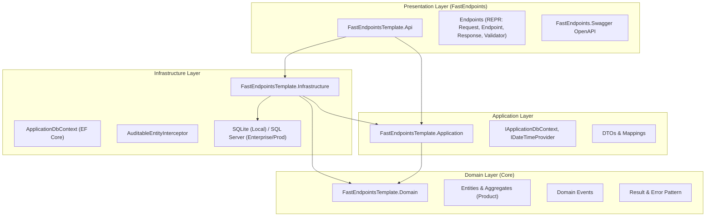
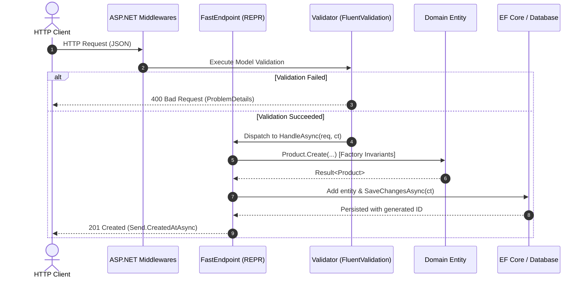

# 🏛️ Architecture Documentation

This repository follows **Clean Architecture** combined with **Vertical Slice Architecture** and the **REPR (Request-Endpoint-Response)** pattern using **FastEndpoints**.

---

## 1. System Layers Diagram

---

## 2. FastEndpoints REPR Lifecycle

---

## 3. Layer Separation Guarantees

| Layer | Can Reference | Forbidden References |
|---|---|---|
| **Domain** | None (BCL only) | Application, Infrastructure, Api, EF Core, ASP.NET |
| **Application** | Domain | Infrastructure, Api, EF Core provider implementations |
| **Infrastructure** | Domain, Application | Api |
| **Api** | Domain, Application, Infrastructure | MVC Controllers, Direct database drivers |

These constraints are tested automatically on every build in `FastEndpointsTemplate.ArchitectureTests` using `NetArchTest.Rules`.
