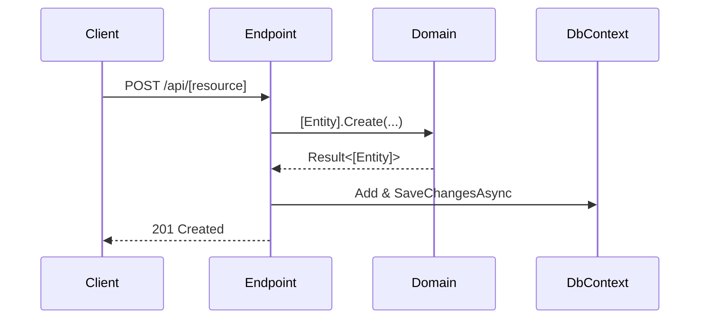

# Technical Design: [Change ID or Feature Name]

---

## 1. Architecture Decision Record (ADR)
- **Context**: Problem statement and alternatives considered.
- **Decision**: Chosen technical approach (e.g. why FastEndpoints REPR slice instead of service extraction).
- **Consequences**: Trade-offs accepted.

---

## 2. API Contract Specification
```json
// Example Request Body
{
  "name": "Acme Corp",
  "email": "contact@acme.com"
}
```

---

## 3. Data Model & Migration Design
- Entity changes in `Domain/Entities/`.
- EF Core schema alterations in `Infrastructure/Persistence/Configurations/`.

---

## 4. Sequence & Logic Flow

